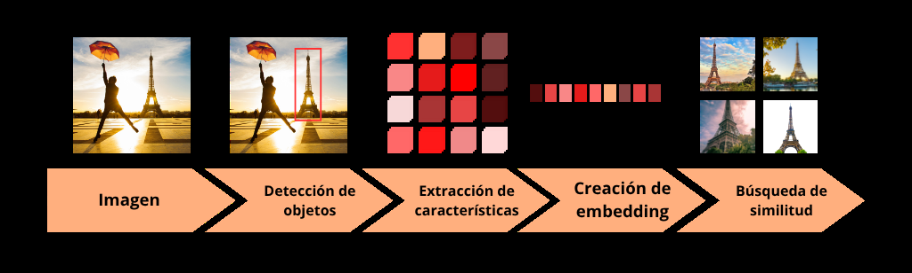
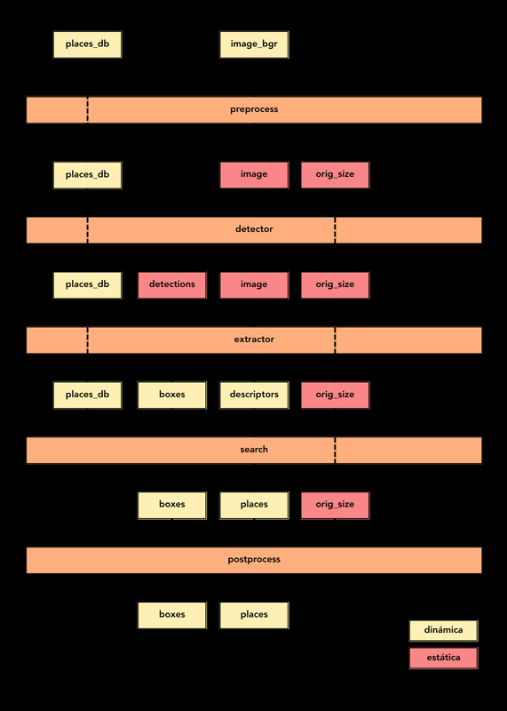
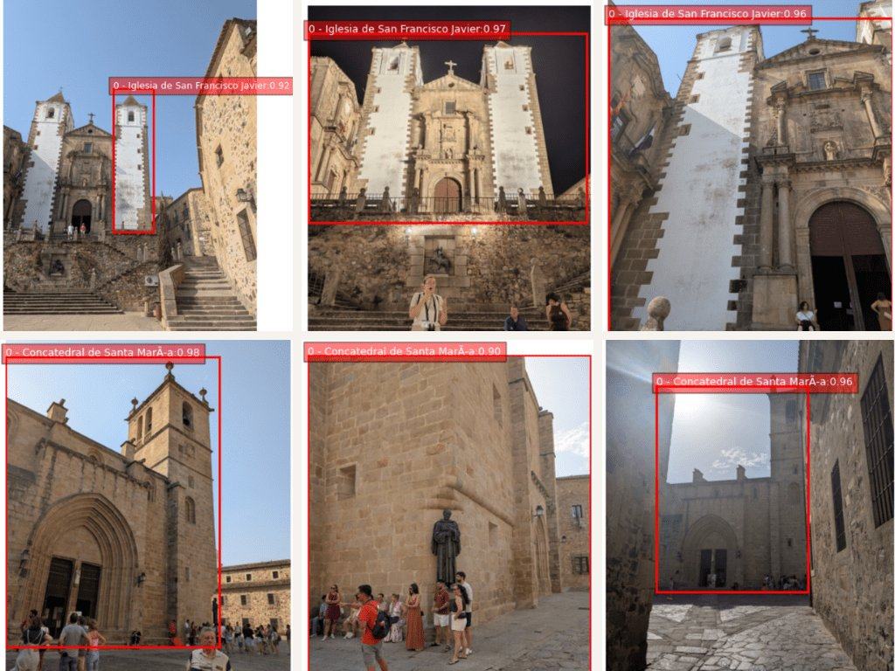

# Landmark Detection with Retrieval

**Detecting tourist landmarks with computer vision for augmented reality applications.**

Master's thesis (TFM) of the *Master in Artificial Intelligence* at Universidad Internacional de Valencia (VIU), 2025.
Author: **Rodrigo Díaz Velasco** · Supervisor: Yaneth Moreno Caldera

📄 [Thesis (PDF, Spanish)](docs/TFM_Rodrigo_Diaz_Velasco.pdf) · 📊 [Defense slides (PDF, Spanish)](docs/TFM_Presentation_Rodrigo_Diaz_Velasco.pdf)

---

## Overview

The goal is to recognise points of interest (monuments, churches, palaces…) in photos taken with a phone and show them in augmented reality. Instead of training a classifier per landmark, the system combines **object detection** with **image retrieval**: regions that may contain a building are cropped, described with a global embedding and matched against a database of reference images. **New landmarks can be added without retraining**: you only add their images to the database.



1. **Detection**: [YOLOv8n](https://docs.ultralytics.com/models/yolov8/) trained on [Open Images V7](https://docs.ultralytics.com/datasets/detect/open-images-v7/), restricted to 45 building and landmark classes. The full image is always kept as an additional candidate.
2. **Feature extraction**: a ResNet-50 backbone with [CVNet-Global](https://github.com/sungonce/CVNet) weights, applied to 224×224 crops (RoIPool) of every detection at three scales.
3. **Embedding**: [SuperGlobal](https://github.com/ShihaoShao-GH/SuperGlobal) pooling (Regional-GeM → GeM → Scale-GeM), producing an L2-normalised 2048-d descriptor.
4. **Similarity search**: cosine similarity against the database, top-k voting per landmark (`topk`, `min_sim`, `min_votes`).
5. **Post-processing**: nested boxes of the same landmark are removed and the remaining ones are merged.

The whole pipeline, from the raw BGR image to the final boxes and landmark ids, is exported as **a single ONNX model**. It takes the embedding database as a second input, so the same model works with any set of landmarks. The Android app runs this model on the device with ONNX Runtime.

<p align="center"></p>

## Results

**Revisited Oxford and Paris** (full-image queries, CPU inference time per image). The values are for the optimised configuration, with the change relative to the initial configuration from the literature in brackets (Table 5.6 of the thesis):

| Metric | ROxford Easy | ROxford Medium | ROxford Hard | RParis Easy | RParis Medium | RParis Hard |
|---|---|---|---|---|---|---|
| mAP   | 77.11 (+2.1 %) | 61.52 (+4.8 %) | 35.29 (+16.3 %) | 88.58 (+0.4 %) | 76.59 (−0.1 %) | 55.99 (+1.6 %) |
| mP@1  | 97.06 (+0.0 %) | 95.71 (+0.0 %) | 74.29 (+19.3 %) | 98.57 (+1.5 %) | 98.57 (+0.0 %) | 91.42 (−1.5 %) |
| mP@5  | 86.84 (+3.3 %) | 85.86 (+5.0 %) | 59.43 (+11.2 %) | 95.52 (+0.6 %) | 97.43 (−0.3 %) | 91.43 (−0.6 %) |
| mP@10 | 83.01 (+5.8 %) | 80.71 (+4.6 %) | 48.71 (+10.4 %) | 93.52 (+0.1 %) | 96.57 (−0.7 %) | 89.00 (−0.5 %) |
| Time  | 0.732 s (+2.2 %) | | | 0.823 s (−16.2 %) | | |

**Field test in Cáceres (Spain)**: a database of 489 images of 14 landmarks of the old town (7.5 MB of embeddings) and a ~105 MB ONNX model running inside an ARCore app:



## Repository structure

```
├── docs/                   Thesis, slides and README figures
├── landmark_detection/     The pipeline (PyTorch modules + ONNX export)
│   ├── pipeline.py         Pipeline_Landmark_Detection: builds, exports and runs every stage
│   ├── preprocess.py       Resize / normalise the BGR image
│   ├── extract.py          YOLO decoding + NMS + multi-scale crops + CVNet + SuperGlobal
│   ├── backbone.py         CVNet ResNet-50 encoder
│   ├── pooling.py          Regional-GeM, GeM and Scale-GeM
│   ├── search.py           Similarity search, voting and box refinement
│   ├── postprocess.py      Rescale boxes to the original image
│   └── utils.py            Visualisation and database import/export helpers
├── benchmark/              Revisited Oxford & Paris protocol + evaluation and plotting utilities
│   └── results/results.csv Metrics of every configuration tested (~220 runs)
├── notebooks/              Experiments (see below)
├── configs/                Pipeline config of the app, OIV7 and Cáceres class names
├── scripts/export_onnx.py  Exports the end-to-end ONNX model from a config file
├── android_app/            Android AR demo (Kotlin, ARCore, ONNX Runtime)
└── test_images/            A few sample photos of Cáceres (taken by the author)
```

### Notebooks

| Notebook | Content | Needs |
|---|---|---|
| [01_pipeline_walkthrough](notebooks/01_pipeline_walkthrough.ipynb) | Runs the pipeline stage by stage and end to end on Cáceres photos | weights |
| [02_benchmark_evaluation](notebooks/02_benchmark_evaluation.ipynb) | mAP / mP@k on ROxford and RParis (baseline, Table 5.3) | weights + datasets |
| [03_parameter_sweep](notebooks/03_parameter_sweep.ipynb) | Runs a set of configurations and appends the metrics to `results.csv` | weights + datasets |
| [04_results_visualization](notebooks/04_results_visualization.ipynb) | Figures of Chapter 5 from `results.csv` | nothing |
| [05_search_tuning_roxford](notebooks/05_search_tuning_roxford.ipynb) / [06_search_tuning_rparis](notebooks/06_search_tuning_rparis.ipynb) | Precision vs. coverage for `topk`, `min_votes`, `min_sim` | weights + datasets |
| [07_inference_time](notebooks/07_inference_time.ipynb) | Average inference time of the ONNX pipeline | weights + datasets |
| [08_export_for_android](notebooks/08_export_for_android.ipynb) | How the app's `places_db.bin` / `label_map.json` were built | your own image dataset |

The notebooks keep their original outputs, so you can read them on GitHub without running anything. Their code comments are in Spanish.

## Getting started

### 1. Install

Python ≥ 3.10:

```bash
pip install -r requirements.txt
```

### 2. Download the pretrained weights

The weights are not stored in this repository. Put them in `landmark_detection/models/`:

| Model | File | Source |
|---|---|---|
| YOLOv8n Open Images V7 | `yolov8n-oiv7.pt` | [Ultralytics](https://docs.ultralytics.com/datasets/detect/open-images-v7/). Downloaded automatically by `ultralytics` on first use |
| CVNet-Global ResNet-50 | `CVPR2022_CVNet_R50.pyth` | [sungonce/CVNet](https://github.com/sungonce/CVNet): Google Drive link in the *Pretrained models* section of its README |

### 3. Export the ONNX pipeline

```bash
python scripts/export_onnx.py --config configs/app.json \
    --output android_app/app/src/main/assets/pipeline/pipeline.onnx
```

This creates every stage of the pipeline in `landmark_detection/models/` (preprocess, detector, extractor, searcher, postprocess and the fused `pipeline-app.onnx`) and copies the fused model into the Android app. To try other parameters, change the JSON. Each key is an argument of `Pipeline_Landmark_Detection`.

### 4. Use it from Python

```python
from landmark_detection.pipeline import Pipeline_Landmark_Detection
from landmark_detection.utils import load_places_db, show_bboxes

pipeline = Pipeline_Landmark_Detection(...)  # same parameters as configs/app.json
places_db = load_places_db("android_app/app/src/main/assets/pipeline/places_db.bin")

boxes, scores, landmark_ids = pipeline.run("test_images/caceres-14.jpg", places_db)
show_bboxes("test_images/caceres-14.jpg", boxes, "configs/caceres_landmarks.yaml", landmark_ids, scores)
```

### 5. Build your own landmark database

`Pipeline_Landmark_Detection.build_image_database` computes the embeddings of a folder of images. It takes a DataFrame mapping each `filename` to a `landmark_id` and returns `places_db`, an `(N, 2048 + 1)` matrix of descriptors with the landmark id in the last column. `landmark_detection.utils.export_places_db` saves it as `places_db.bin` + `label_map.json`, the format the Android app reads. See [notebook 08](notebooks/08_export_for_android.ipynb) and Appendix B of the thesis.

### Benchmark datasets

```bash
python -c "from benchmark.revisitop.download import download_datasets; download_datasets('.')"
```

This downloads Revisited Oxford 5k and Paris 6k into `datasets/`.

## Android app

[`android_app/`](android_app/) is an ARCore application that runs the ONNX pipeline on camera frames and anchors the detected landmarks in the 3D scene. See [android_app/README.md](android_app/README.md).

## Data availability

The Cáceres image dataset (489 images taken by the author) is not available. Its embeddings are included in [`android_app/app/src/main/assets/pipeline/places_db.bin`](android_app/app/src/main/assets/pipeline/), so the pipeline and the app can still be used for these 14 landmarks.

## Acknowledgements

This work builds on [CVNet](https://github.com/sungonce/CVNet) (Lee et al., CVPR 2022), [SuperGlobal](https://github.com/ShihaoShao-GH/SuperGlobal) (Shao et al., ICCV 2023), [Ultralytics YOLOv8](https://github.com/ultralytics/ultralytics), the [Revisited Oxford and Paris](https://github.com/filipradenovic/revisitop) benchmark (Radenović et al., CVPR 2018) and the [ARCore samples](https://github.com/google-ar/arcore-android-sdk).

## License

[MIT](LICENSE). Third-party code keeps its original license (see [LICENSE](LICENSE)).
